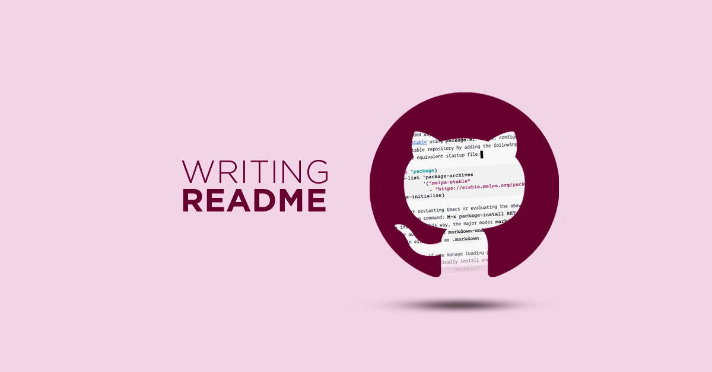

# Hi 👋, I'm Vedanti  
I'm a passionate Full Stack Developer exploring AI & IoT.  

---

## 🛠️ Skills  
  
  
  

---

## 📊 GitHub Stats  
  

---

---

## 🌟 Projects  
- 🎬 [Theatre Booking System](#)  
- 🔥 [Fire Detection System](#)

###  Vedanti Image

---

# 👋 Hi, I’m Sakshi

Welcome to my GitHub Profile!

## 🔧 Skills
- Python
- HTML & CSS
- Git & GitHub

## 🌟 Projects (by Sakshi)
- 🎬 Theatre Ticket Booking System  
- 🌐 SNMP Network Monitoring Project  
- 🔥 Fire Detection IoT System

### 🙋‍♀️ Sakshi
- 🔧 Interested in development and system design  
- 📚 Currently working on: Networking & IoT Projects  
- 🎯 Goal: Master real-world project building  

---

### 📊 Sakshi’s GitHub Stats

---

## 📫 Connect With Us
- [GitHub](https://github.com/VedantiRamde)  
- [LinkedIn](#)  
- [Email](mailto:your.email@example.com)  

### Sakshi image

### 📘 About the Project

This project is focused on designing a **standout GitHub Profile README** that represents our skills, roles, and contributions.  
It aims to make our GitHub profiles more interactive, professional, and visually appealing.

🎯 **Goal:**  
To create a personalized GitHub profile README that showcases our skills, roles (Frontend, Backend, Tester), and collaborative work using Git and GitHub.

### Team Roles
👩‍💻 **Vedanti** – Frontend Developer: Designed the layout, badges, and styling.  
👩‍💻 **Sakshi** – Backend Developer: Managed GitHub integration, stats, and repository setup.  
🧪 **Tester** – Reviewed the final output for correctness and visual consistency.

🛠️ **Tools & Technologies:**  
- Markdown  
- Git & GitHub  
- Shields.io (for badges)  
- GitHub Readme Stats API  
- Visual Studio Code

🚀 **Final Output:**  
A dynamic and visually appealing GitHub profile page that represents each team member’s skills and work effectively.
